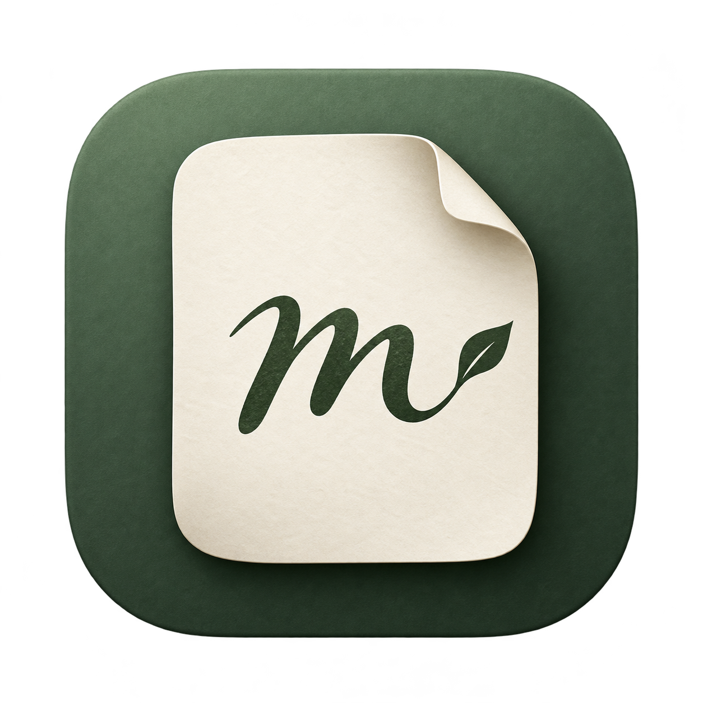
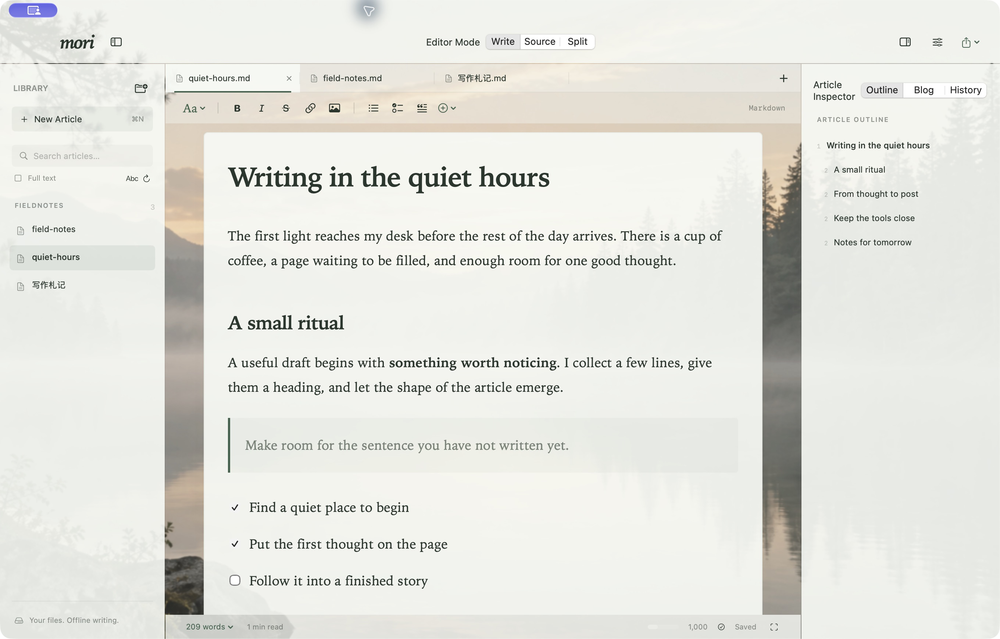
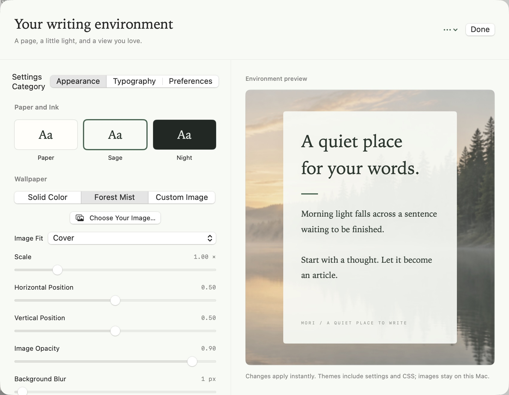
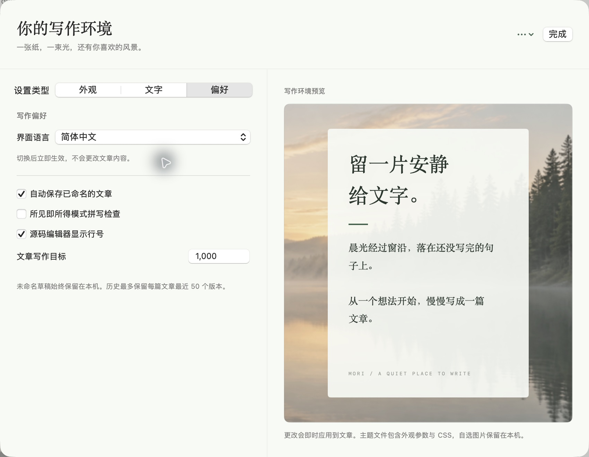

<p align="center"><a href="README.md">English</a> · <strong>简体中文</strong></p>
<p align="center"></p>
<h1 align="center">Mori</h1>
<p align="center">给博客写作，留一片安静的地方。</p>
<p align="center">原生 macOS · Markdown · 中英切换 · 离线写作 · MIT 开源</p>
<p align="center"><a href="https://github.com/KevinWang12138/mori/releases/latest">下载 Mac 应用</a> · <a href="docs/USER_GUIDE.md">使用说明</a> · <a href="https://github.com/KevinWang12138/mori/issues">反馈问题</a></p>

Mori 是为博客写作者设计的原生 Mac Markdown 编辑器。默认直接在文章中编辑，输入 Markdown 标记后转换为标题、列表和引用；也可以切到源码或分栏预览。设计参考 Typora 的直接写作体验，采用独立实现、独立视觉和独立品牌。



*真实 macOS 应用截图，使用公开示例文章，展示直接写作、文章库、大纲和可自定义背景。*

## 写作

- 所见即所得、源码编辑、源码与预览分栏三种模式。
- 标题、加粗、斜体、删除线、行内代码、链接、引用、嵌套列表与任务列表。
- 可编辑表格、增删行列、列宽调整；代码高亮和代码块语言选择。
- KaTeX 公式、Mermaid 图表，源码预览支持脚注和经过净化的 HTML。
- 选区格式工具、`/` 插入菜单、查找替换、撤销重做。
- 图片导入、粘贴、拖放和相对路径；图片保存在文章旁边的 `assets/`。
- 文章库、递归文件夹索引、文件名搜索、可选正文搜索、大纲跳转、多标签页。
- 中文与英文混合字词统计、阅读时间、写作目标、专注和打字机模式。

## 博客与文件

- 空白、Astro、Hugo、Jekyll 四种模板。
- Front Matter 面板编辑标题、摘要、日期、slug、标签、分类、封面和草稿状态。只修改你变更的字段，保留其他 YAML 字段和注释。
- 自动保存、重启后的会话与未命名草稿恢复；文件外部变化时核对版本，保护当前稿件。
- 保存原有 UTF-8 BOM 与 CRLF 换行；每篇文章保留最近 50 个本机历史版本。
- 导出独立 HTML、PDF，支持系统打印和复制 HTML / Markdown。HTML 包含本地图片和公式字体。

## 自定义写作环境

暖纸、青苔、墨夜三套基础主题。背景可以用内置林间晨雾，也可以导入你自己的照片和纹理。

| 调整项 | 支持内容 |
| --- | --- |
| 图片铺放 | 铺满、完整显示、平铺 |
| 构图 | 缩放、水平位置、垂直位置 |
| 画面 | 图片不透明度、模糊、饱和度 |
| 可读性 | 背景底色、遮罩颜色、遮罩浓度 |
| 纸面 | 文章纸面和侧栏的不透明度分别调整 |
| 文字 | 三种字体、字号、行距、纸面宽度 |
| 扩展 | 自定义文章 CSS、JSON 主题导入导出 |

自选背景会拷贝到应用资料目录，移动原图不会使背景消失。导出主题不打包私人背景图片，可自行分享图片并在另一台 Mac 导入。



## 界面语言

在 **Mori → 语言** 中直接切换，或打开 **写作环境（⌘,）→ 偏好 → 界面语言**，选择 **跟随系统**、**English** 或 **简体中文**。默认跟随系统首选语言，暂未支持的语言使用英文。

选择会自动记住，界面、编辑器工具和提示立即切换。文章原文、Front Matter、光标、撤销历史和原有外观设置都会保留。语言偏好与主题文件独立，导入主题不会改变界面语言。



## 下载与安装

需要 **macOS 14 或更新版本**。发布包是 Apple Silicon 与 Intel 通用应用。

1. 在 [Releases](https://github.com/KevinWang12138/mori/releases/latest) 下载 DMG 或 ZIP。
2. 打开 DMG，将 Mori 拖到 Applications；ZIP 解压后同样将 Mori.app 移到 Applications。
3. 启动 Mori，打开文章或博客文件夹。

### macOS 首次打开

0.1.1 使用 ad-hoc 签名，尚未使用 Apple Developer ID 公证。首次启动出现“Mori 未打开”提示时：

1. 点击「完成」，保留已安装的应用。
2. 打开「系统设置 → 隐私与安全性」。
3. 找到关于 Mori 的提示，点击「仍要打开」，再确认「打开」。

操作依据见 [Apple 关于打开未公证应用的说明](https://support.apple.com/zh-cn/102445)。Release 提供 `SHA256SUMS.txt`，可用于核对下载的 DMG 或 ZIP。

确认这份应用来自本仓库并完成校验后，也可以在终端仅清除这份已安装应用的隔离标记：

```bash
xattr -dr com.apple.quarantine /Applications/Mori.app
open /Applications/Mori.app
```

## 本地构建

需要 Xcode 15+、Swift 5.9+、Node.js 20+ 和 npm。打开 `Package.swift` 可以在 Xcode 编辑项目；发布应用使用构建脚本。

```bash
git clone https://github.com/KevinWang12138/mori.git
cd mori
cd Web && npm ci && cd ..
./scripts/build-app.sh
open build/Mori.app
```

默认生成 universal 应用。Apple Silicon 上仅构建 ARM 版本可设置 `MORI_UNIVERSAL=0`。Web 依赖和字体全部随应用打包，应用运行时无需 Node.js 或本地服务。

验证：

```bash
./scripts/check.sh
```

项目结构：

```text
Sources/Mori/      SwiftUI 界面、AppKit 文件与窗口集成、WebKit 桥接
Sources/MoriCore/  文件写入与冲突校验、Markdown 分析、恢复与历史
Web/src/          Tiptap 富文本、CodeMirror 源码、Markdown 预览
Tests/            文件安全与文章分析测试
Web/tests/        Markdown 往返、元信息与预览测试
scripts/          检查、应用构建和精确 SHA 发布
```

## 当前边界

- 扩展语法如脚注、引用式链接、MDX、嵌入 HTML、指令块和 `[TOC]` 自动使用源码模式，避免富文本转换损失原文；分栏可预览受支持的内容。MDX 组件不执行。
- 普通 Markdown 在实际富文本编辑后会规范化标记与空行；单纯打开文件或切换模式不会写回文件。
- 文章需要 UTF-8，单文件最大 20 MB；图片最大 25 MB。正文全文检索索引单篇小于 2 MB 的文章。正文搜索通过搜索结果点击进入，文章内部查找由编辑器完成。
- 所见即所得查找支持跨内联格式匹配、前后导航、大小写、逐处和全部替换；源码模式另提供正则和整词匹配。
- 没有云账户、发布到博客平台的 API 或内置同步。可以把 Markdown 文件夹放到自己的 Git、iCloud 或其他同步目录。
- 读取文章中明确引用的 HTTPS 图片时会请求对应图片地址；链接只在用户点击时交给系统浏览器。应用不发送遥测、不上传文章。
- 应用支持英文与简体中文；macOS 系统对话框跟随系统语言。仓库 README 支持中英文切换。

## 开源

[MIT License](LICENSE)。欢迎提交问题和贡献改动。第三方依赖见 [THIRD_PARTY_NOTICES.md](THIRD_PARTY_NOTICES.md)，安全问题见 [SECURITY.md](SECURITY.md)。Mori 与 Typora 无隶属关系。
